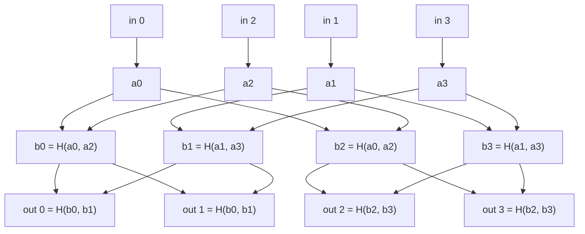
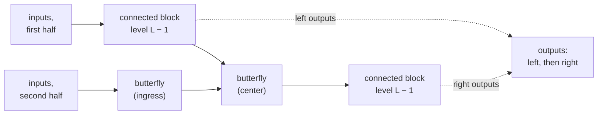
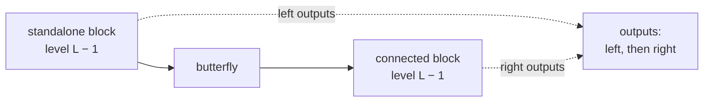
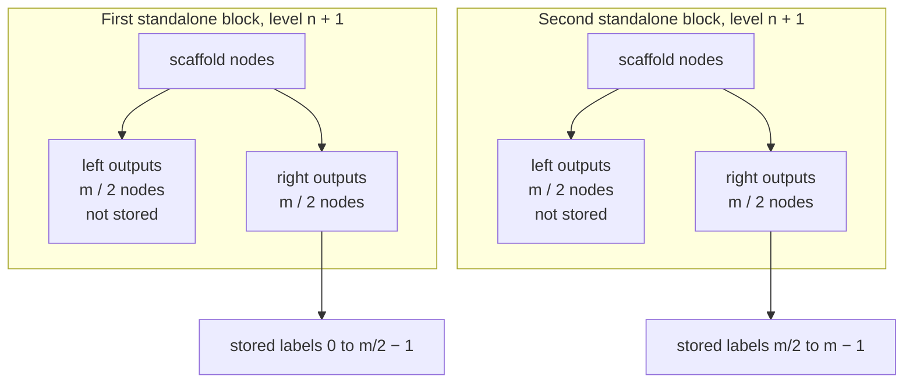

# Labels: what they are and how they are computed

This document explains the data that a wipe fills memory with: what a label is,
how one is computed, why it cannot be recomputed quickly, and where each label
ends up in the memory being wiped.

The code is the reference. The labelling rules live in
`pose-common/src/graph.c` and `pose-common/src/hash.c`. If this document and
that code disagree, the code is right.

For how labels are moved around a server tray and challenged over the network,
see [`sink-source-architecture.md`](sink-source-architecture.md).

## Overview

A *Proof of Secure Erasure* fills a memory with data that only fits if the old
contents are gone, and then checks that the data is really there. The data is a
sequence of 32-byte **labels**, one per 32 bytes of memory. Writing the labels
*is* the erasure.

The check is a quiz against a stopwatch. The verifier asks for the label at a
random position and accepts the answer only if it is correct and arrives within
a few milliseconds. For that to prove anything, a label must have two
properties:

- **It cannot be guessed or prepared in advance.** Every label depends on a
  random 32-byte seed that the verifier picks at the start of the run.
- **It cannot be rebuilt in time.** A machine that kept its old data and threw
  the labels away must not be able to recompute the one it is asked for before
  the stopwatch runs out.

The second property is the hard one, and it is what the rest of this document
is about. A plain scheme such as `label[i] = hash(seed, i)` fails it: one hash
takes well under a microsecond, so a cheat could store nothing and compute any
answer on demand.

The fix is to make each label the result of a long **chain** of hashes, where
every hash needs the output of earlier ones. Hashes in a chain cannot be done
in parallel, so no amount of hardware shortens the chain. The pattern of "which
hash needs which earlier outputs" is a graph, and it is designed so that the
chain behind every stored label is long, even for a cheat who keeps some of the
intermediate values.

The price is work. To produce the labels honestly, the wiping machine must
compute the whole graph, which is a few hundred hashes for every label it
stores. That is why a wipe takes far longer than writing zeros.

## Vocabulary

| Term | Meaning |
|---|---|
| **Label** | One 32-byte hash output. |
| **Block** | One 32-byte slot of the memory being wiped. Block `i` holds label `i`. |
| **Session seed** | 32 random bytes chosen by the verifier for one session. |
| **Chunk** | A group of `chunk_blocks` consecutive blocks whose labels are computed together, from one graph. Chunks are independent of each other. |
| **Chunk seed** | 32 bytes derived from the session seed and the chunk's index. |
| **Node** | One hash computation in a chunk's graph. Its output is that node's label. |
| **Predecessor** | A node whose label is an input to another node's hash. A node has zero, one or two. |
| **Source node** | A node with no predecessors. |
| **Scaffold** | All the nodes of one chunk's graph. Most exist only to make the chains long. |
| **Output set** | The `chunk_blocks` scaffold nodes whose labels are stored. |
| **γ** (gamma) | The length of the hash chain a cheat must redo to rebuild one stored label. |

`chunk_blocks` is always a power of two. The library's built-in default is
4,096 (`POSE_CHUNK_BLOCKS`). The verifier chooses the value for each session,
and its own default is 131,072 (2^17). Both appear in the examples below.

## From a memory to chunks

A target is cut into 32-byte blocks, and the blocks are grouped into chunks.
For 1 GiB of memory:

```
blocks:  1,073,741,824 / 32 = 33,554,432 labels

chunk_blocks = 4,096    one chunk = 128 KiB    8,192 chunks
chunk_blocks = 131,072  one chunk = 4 MiB        256 chunks
```

Each chunk gets its own seed:

```
chunk seed = BLAKE3-derive-key("pose-db/chunk-seed",
                               session seed || chunk index as 8 bytes, big-endian)
```

Two things follow from that:

- **Chunks are independent.** Nothing computed for one chunk is needed by
  another, so chunks can be computed in parallel and in any order.
- **Position is baked in.** The chunk index counts from the start of the
  target's address space, not from the start of the session. The same seed
  gives different labels at different addresses. The exact formula is in
  [Where each label is stored](#where-each-label-is-stored).

From here on, everything happens inside one chunk.

## How one label is computed

Every node in a chunk's graph has a number, its **node index**, counted from 0
within the chunk. A node's label is the hash of a fixed 192-byte message:

```
offset   size   field
     0      8   node index, big-endian
     8     56   zeros
    64     32   label of the first predecessor   (zeros if there is none)
    96     32   label of the second predecessor  (zeros if there is none)
   128     32   chunk seed
   160     32   graph descriptor
```

| Field | Why it is there |
|---|---|
| Node index | Makes every node's label different, even when two nodes have the same predecessors. |
| Predecessor labels | Create the dependency: this hash cannot start until those labels exist. |
| Chunk seed | Ties the label to this run and this position in the target. |
| Graph descriptor | A hash of the graph's shape: `chunk_blocks`, the graph parameter `n` and the label width (256 bits). Labels from one chunk size can never be passed off as labels from another. |

The message is three 64-byte blocks, which is three BLAKE3 compression calls.
The layout is the same for every node, so nodes can be hashed in SIMD batches.

When a node has two predecessors, the one with the lower node index always
goes first. That makes the message unambiguous.

### The hash function

`algo` in a session selects the hash. All three give 32-byte labels.

| `algo` | Hash | Notes |
|---|---|---|
| 0 | BLAKE3 | The production choice. Used in keyed mode, with one fixed key for source nodes and another for all other nodes, so the two kinds can never collide. The keys are derived from the strings `pose-db/label/src` and `pose-db/label/int`. The only hash a GPU supports. |
| 1 | SHA-256 | Plain SHA-256 of the same 192 bytes. For throughput comparison only. |
| 2 | AES-PRF | AES-128 CBC-MAC, computed twice with the two halves of the chunk seed as keys. Uses a shorter 112-byte message, because the seed is the key and need not be in the message. |

## The graph

The graph says which nodes are predecessors of which. It is never stored as a
table of edges. It is defined by a recursive rule, and the labeller walks that
rule, computing each node as soon as its predecessors are ready.

It is built from three kinds of piece.

### Piece 1: the butterfly

A butterfly of dimension `d` takes `2^d` labels in and gives `2^d` labels out.
It has `d + 1` layers of `2^d` nodes each:

- **Layer 0:** node `i` has one predecessor, input `i`.
- **Layers 1 to d:** node `i` has two predecessors in the layer above: node `i`
  and the node whose position differs from `i` in one bit. The first of these
  layers uses the highest bit, the last uses the lowest.

A butterfly of dimension 2:



`b0` and `b2` have the same predecessors but different node indexes, so their
labels differ.

The point of a butterfly is mixing. After `d` layers **every output depends on
every input**. You cannot compute any one output without all of the inputs.

A butterfly of dimension `d` has `B(d) = (d + 1) × 2^d` nodes.

### Piece 2: the connected block

A connected block of level `L` takes `2^L` labels in and gives `2^L` labels
out. At level 0 it is a single node with one predecessor. At level `L` it is
made of two connected blocks of level `L − 1` with two butterflies between
them:



1. The first half of the inputs feeds a connected block of level `L − 1`. Its
   outputs are the *left outputs*.
2. The second half of the inputs goes through a butterfly, the *ingress*.
3. A second butterfly, the *center*, combines the two. Its layer 0 is special:
   node `i` has two predecessors, left output `i` and ingress output `i`.
4. The center's outputs feed another connected block of level `L − 1`. Its
   outputs are the *right outputs*.

The right outputs therefore sit behind everything else in the block. They
depend on every input.

A connected block has `C(L) = 2 × C(L − 1) + 2 × B(L − 1)` nodes, with
`C(0) = 1`.

### Piece 3: the standalone block

A standalone block is the same idea with no inputs. At level 0 it is a single
source node. At level `L`:



1. A standalone block of level `L − 1` produces the *left outputs*.
2. A butterfly mixes them.
3. A connected block of level `L − 1`, fed by the butterfly, produces the
   *right outputs*.

A standalone block has `S(L) = S(L − 1) + B(L − 1) + C(L − 1)` nodes, with
`S(0) = 1`. It grows quickly:

| Level | Nodes `S(L)` |
|---|---|
| 0 | 1 |
| 1 | 3 |
| 2 | 11 |
| 5 | 383 |
| 8 | 7,679 |
| 12 | 278,527 |
| 17 | 18,087,935 |

Only the very first node of a standalone block is a source node. Everything
else descends from it.

### The whole graph for one chunk

For a chunk of `m = chunk_blocks` labels, let `n` be `log2(m) − 1`, so that
`2^(n+1) = m`. The chunk's graph is **two standalone blocks of level `n + 1`**,
side by side, with no edges between them. Node indexes run through the first
copy and then carry on through the second.

Each copy has `m` outputs: `m / 2` left and `m / 2` right. **The output set is
the right outputs of both copies**, `m` labels in total. These are the labels
that get stored. They are the nodes at the very end of each copy, behind all of
the mixing.



The scaffold is much larger than the output set:

| | `chunk_blocks` = 4,096 | `chunk_blocks` = 131,072 |
|---|---|---|
| Graph parameter `n` | 11 | 16 |
| Level of each standalone block | 12 | 17 |
| Scaffold nodes, `2 × S(n + 1)` | 557,054 | 36,175,870 |
| Stored labels | 4,096 | 131,072 |
| Hashes per stored label | 136 | 276 |
| γ, which is `2^n` | 2,048 | 65,536 |

For the 1 GiB example at `chunk_blocks` = 131,072, that is 256 chunks of
36 million hashes each: about 9.3 billion hashes to store 33.5 million labels.

## Why this cannot be faked

**No stored label can be rebuilt in time.** γ is the number of hashes that must
be done one after another to rebuild a stored label that was thrown away. For
this graph γ is `2^n`, half of `chunk_blocks`. The construction is
*depth-robust*: the chain stays long even if the cheat keeps a share of the
scaffold labels to start from. The proof of that is in the PoSE-DB paper; this
code implements the paper's graph and does not re-derive it.

The verifier turns γ into a time limit. It assumes a cost per hash (150 ns by
default) and works out how many hashes fit into a challenge's time limit. Call
that `q`. A plan is refused unless γ is larger than `q`, and the defaults keep
a margin of 1.5. With `chunk_blocks` = 131,072 and a 6 ms limit, `q` is 40,000
against a γ of 65,536.

This is why the verifier does not use the library's default chunk size. A
4,096-block chunk has a γ of 2,048, which is about 0.3 ms of hashing: less
than a network round trip.

**Only the output set is stored, and that is deliberate.** The paper's
guarantee covers the output set and nothing else. Scaffold nodes near the start
of the graph have short chains behind them, so a challenge on one of those
would prove nothing. Storing only the output set means every byte of the wiped
memory holds a label that is worth challenging. The cost is that the scaffold
is hashed and then discarded.

**A bigger chunk is safer and slower.** Doubling `chunk_blocks` doubles γ. It
also raises the hashes per stored label (136 at 2^12, 276 at 2^17, 384 at
2^20) and the working memory needed to compute a chunk.

## How the labeller walks the graph

The recursive definition above is also the algorithm. The labeller calls the
standalone rule, which calls the butterfly and connected rules, and each node
is hashed the moment it is reached. Node indexes are handed out in that order,
so a predecessor always has a lower index than the node that needs it.

Three properties of the implementation are worth knowing.

**Working memory is small.** A scaffold of 36 million labels would take over
1 GiB if every label were kept. It is not needed: once a piece of the graph has
produced its outputs, its inner labels are never read again and their space is
reused. The labeller keeps the two copies' output arrays plus a reusable arena,
`20 × chunk_blocks / 2` labels in all:

| `chunk_blocks` | Scaffold if kept whole | Working memory actually used |
|---|---|---|
| 4,096 | 17 MiB | 1.25 MiB |
| 131,072 | 1.08 GiB | 40 MiB |
| 1,048,576 | 12 GiB | 320 MiB |

This is per thread, and it depends only on the chunk size, never on the size of
the target. `pose_graph_scratch_bytes_inplace()` returns the figure.

A simpler reference path that does keep every label also exists
(`pose_graph_label()`, `pose_graph_challenge()`). The tests use it to check the
memory-saving path byte for byte.

**Chunks run in parallel, one per thread.** A fixed pool of threads is started
once. The thread count is the number of CPUs the process may run on, capped at
build time by `POSE_REGION_THREADS_MAX` (64 by default). Each thread has its
own working memory and labels one chunk at a time.

**Nodes in a layer are hashed in batches.** The nodes of one butterfly layer do
not depend on each other, so up to 16 are hashed in one SIMD call. Batching
changes speed only. It never changes a label.

### On a GPU

The CUDA labeller computes the same graph with the same hash inputs, so its
labels are byte-identical to the CPU's, and a verifier cannot tell which one
produced them. It can only use BLAKE3. Several scheduling strategies exist
(`level`, `block`, `thread`, `warp`), chosen at build time; they differ in
speed, not in output. The details are in the header comments of
`pose-common/src/cuda/label_gpu_*.cu` and `pose-common/include/gpu_session.h`.
[`common-library.md`](common-library.md) documents the CPU library's API.

## Where each label is stored

A session covers bytes `[base, base + size)` of a target and holds `size / 32`
labels. Label `i` of the session is stored at:

```
base + i × 32
```

Within a chunk, the output set is stored in order: the first copy's right
outputs, then the second copy's.

To find the label that belongs at block `i`, in either direction:

```
global chunk index = (base / 32) / chunk_blocks  +  i / chunk_blocks
position in chunk  =  i % chunk_blocks
```

The global chunk index goes into the chunk seed derivation shown earlier. A
worked example of these two lines is in
[`sink-source-architecture.md`](sink-source-architecture.md#the-placement-contract).

For RAM, `base` is a physical address. For a disk it is the byte offset from
the start of the device. For a GPU it is 0.

### What the verifier does with a challenge

The verifier knows the session seed, so it can compute any label itself. There
is no shortcut for it either: to check one label it must compute that label's
whole chunk, scaffold included. It does so once per challenged chunk, with the
same C code the daemons use, and compares 32 bytes.

That asymmetry is the design. The verifier may take seconds, before or after
the stopwatch. The machine being tested has milliseconds.

The `pose-label` tool (`pose-common/tools/pose_label.c`) does the same
calculation from the command line and prints the expected label for any block.

## Quick reference

| | Value |
|---|---|
| Label size | 32 bytes |
| Hash input | 192 bytes: node index, two predecessor labels, chunk seed, graph descriptor |
| Hash | BLAKE3 keyed (production), SHA-256 or AES-PRF |
| Labels in 1 GiB | 33,554,432 |
| `chunk_blocks` | a power of two, at most 2^20; library default 4,096, verifier default 131,072 |
| Graph for one chunk | two standalone blocks of level `log2(chunk_blocks)` |
| Stored labels | the right outputs of both blocks, in order |
| γ | `chunk_blocks / 2` |
| Hashes per stored label | 136 at 4,096; 276 at 131,072; 384 at 1,048,576 |
| Working memory per thread | `320 × chunk_blocks` bytes |
| Threads | one per available CPU, at most `POSE_REGION_THREADS_MAX` (default 64) |

## Where to find it in the code

| What | Where |
|---|---|
| Message layout, hash selection, chunk seed, graph descriptor | `pose-common/src/hash.c`, `pose-common/include/hash.h` |
| Butterfly, connected and standalone rules; node counts | `pose-common/src/graph.c` (`emit_connector`, `emit_connected`, `emit_standalone`) |
| The memory-saving labeller the daemons use | `pose-common/src/graph.c` (`do_label_inplace`, the `lc_*` functions) |
| Thread pool and region labellers | `pose-common/src/graph.c`, `pose-common/include/graph.h` |
| AES-PRF message and keys | `pose-common/include/aes_prf.h` |
| GPU labellers | `pose-common/src/cuda/` |
| The graph's edges, for inspection | `pose_graph_edges()` in `pose-common/include/graph.h` |
| Expected label for a block, by hand | `pose-common/tools/pose_label.c` |
| Tests, including CPU/GPU parity | `pose-common/test/` |
| The verifier's γ and time-limit check | `pose-verifier/src/plan.rs` |
| The verifier's recomputation of challenged chunks | `pose-verifier/src/labels.rs` |
