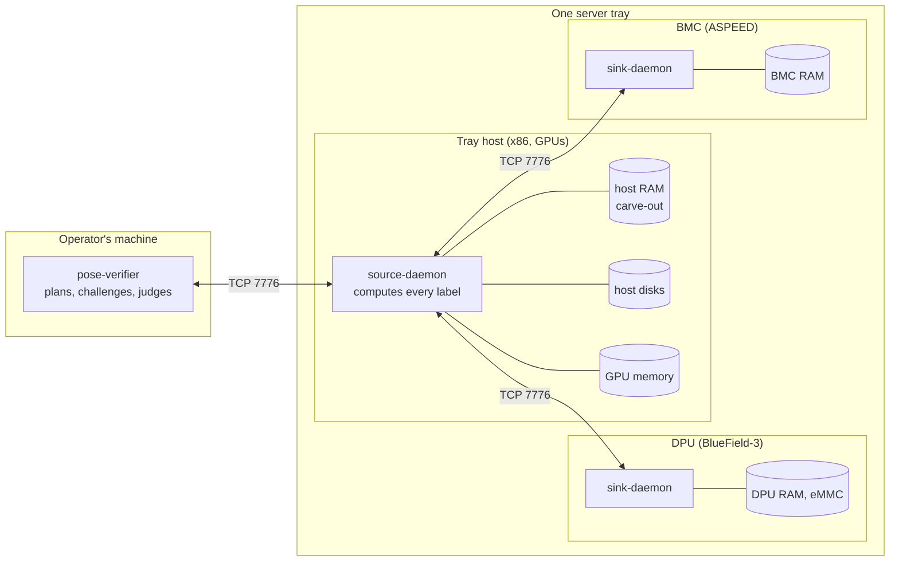
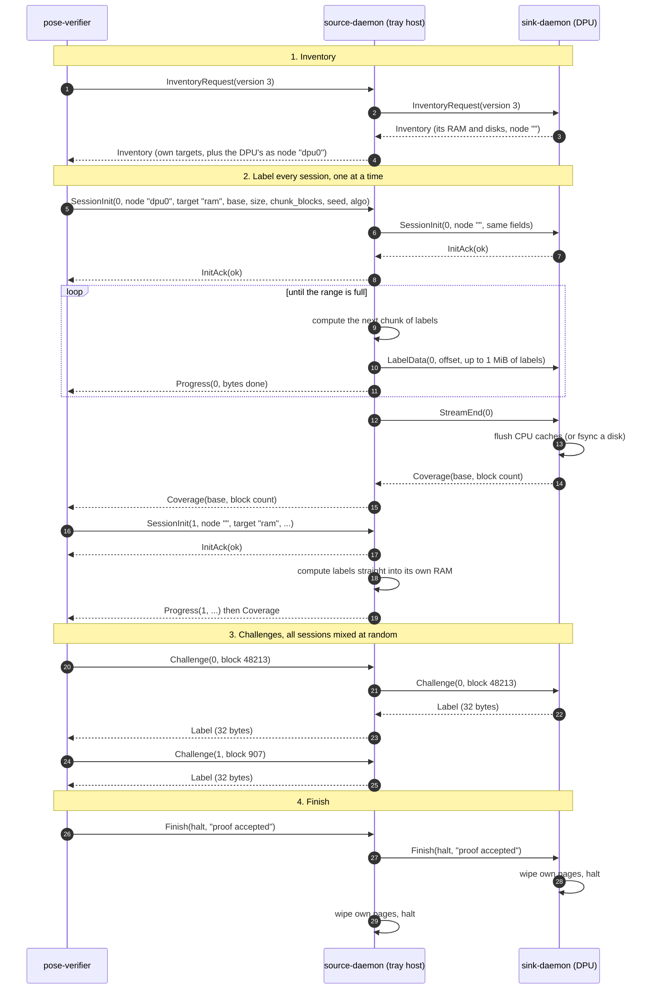

# Sinks, the source, and the wire protocol

This document explains how a whole server tray is wiped and proven wiped: which
program runs where, what each one is responsible for, and exactly what they say
to each other over the network.

The normative description of the protocol is the header comment in
`pose-sink/include/sink_proto.h`. If this document and that header disagree,
the header is right.

## Overview

A *Proof of Secure Erasure* does not ask you to trust that a machine wiped
itself. It makes the machine fill its memory with data that only fits if the
old contents are gone, and then checks that the data is really there.

The data is a long sequence of 32-byte values called **labels**. Three
properties of labels matter here. [`labeling-explained.md`](labeling-explained.md)
covers how they are computed.

- **They are derived from a secret-until-now seed.** The verifier picks a fresh
  random 32-byte seed for each run, so labels cannot be prepared in advance.
- **They are incompressible.** A memory of N bytes filled with labels has no
  room left for anything else. Writing the labels *is* the erasure.
- **Each one is slow to recompute.** A label sits at the end of a long chain of
  hashes that must be done one after another. A machine that threw a label away
  cannot rebuild it in a few milliseconds.

The proof is then a quiz. The verifier asks "what is label number 48,213?" and
starts a stopwatch. The verifier knows the seed, so it can work out the right
answer itself. A correct answer inside the time limit means the label was
stored. Enough correct answers at random positions mean the memory is full of
labels, so nothing of the old contents can remain.

One consequence shapes the whole architecture:

> The proof depends on a label being **stored** in the memory under test and
> being too slow to **recompute** in time. It does not depend on *where the
> label was computed*, or on whether anyone watched it travel.

So a small device does not have to compute its own labels. A big machine with
GPUs can compute them and send them over. That is the split between a *source*
and a *sink*.

## Vocabulary

| Term | Meaning |
|---|---|
| **Label** | One 32-byte value. Also called a *block*: block `i` is the `i`-th label. |
| **Target** | One piece of memory that can be filled with labels: a range of RAM, a whole disk, or a GPU's memory. |
| **Tray** | One server: its host CPUs and GPUs, plus the smaller computers inside it (a DPU, a BMC). |
| **Node** | One machine in the tray, by name. `""` means "the machine you are talking to"; `"dpu0"` is a machine behind it. |
| **Session** | One contiguous range of one target being labelled and proven, with its own seed. Numbered from 0 by the verifier. |
| **Chunk** (or *super-chunk*) | A group of `chunk_blocks` consecutive labels that are computed together. Chunks are independent of each other. |
| **Challenge** | "Send me label `i` of session `s`." |
| **Sink** | Anything that stores labels and answers challenges about them. |
| **Source** | The thing that computes labels. |
| **Verifier** | The program on the operator's machine that runs the proof. |

## Who runs where



There are three programs.

**`sink-daemon`** runs on a device that has memory to wipe but no business
computing labels. It finds its own RAM and disks, reports them, writes down
whatever labels it is sent, reads them back when challenged, and shuts itself
down at the end. It contains no hash code and no graph code. That is
deliberate: this is the program that has to be trusted on the smallest
devices, so it is kept small enough to read in an afternoon.

**`source-daemon`** runs on the tray host, the one machine with real compute.
It plays two parts at once:

- It is a **sink** for its own RAM, disks and GPU memory.
- It is the **source** of labels for every sink-daemon it has been told about.
  It computes their labels and streams them down.

**`pose-verifier`** runs on the operator's machine, outside the tray. It
connects to the source-daemon only. It never talks to a sink-daemon directly.

The verifier therefore sees one machine that appears to hold the whole tray.
When it asks about `dpu0`'s RAM, the source-daemon passes the question along
and passes the answer back.

### Why split it this way

- **The small devices cannot afford to compute labels.** Computing a chunk
  needs working memory proportional to the chunk size, and the BMC has 1 GiB in
  total. A device that only stores labels needs none.
- **The GPUs are on the host.** A GPU generates labels much faster than the
  host's CPUs, so the host is the natural place to generate everything. A
  source-daemon without a GPU falls back to a CPU thread pool.
- **Less code on the devices means less to audit.** A sink-daemon is a network
  loop, a memory map and a `memcpy`.
- **It costs nothing in security**, because of the property quoted above. A
  label computed on the host and written into DPU RAM is exactly as provable as
  one the DPU computed itself.

### One protocol for both links

The link from verifier to source and the link from source to sink carry the
**same messages in the same format**. The rule that makes this work:

> Every party that stores labels is a sink. It reports an inventory, accepts a
> session, says when the session's range is full, answers challenges, and obeys
> Finish.

The only difference between the two kinds of sink is how the labels arrive:

| | Told which range to fill by | Gets its labels from |
|---|---|---|
| `sink-daemon` | `SessionInit` | `LabelData` frames sent by its peer |
| `source-daemon` | `SessionInit` | itself: it computes them from the seed in `SessionInit` |

So the verifier talks to the source-daemon exactly the way the source-daemon
talks to a sink-daemon, minus the two messages that carry labels. When a
message concerns a downstream device, the source-daemon forwards it rather than
translating it. One C file, `pose-sink/src/sink_proto.c`, encodes and decodes
for both daemons, so they cannot drift apart. The verifier has its own Rust
codec, which its tests check frame for frame against that C file.

## What can be labelled

A sink offers three kinds of target.

**RAM** means *carved-out* RAM only. The machine is booted with a kernel
parameter such as `mem=6G`, which makes the kernel ignore most of the installed
memory. The kernel never allocates from the ignored part, so the daemon can map
it through `/dev/mem` and overwrite all of it without corrupting anything
running. The daemon finds the carve-out by taking the DRAM the firmware
declares and subtracting everything the kernel has claimed. The RAM the kernel
*does* use is never labelled; it is reported so the verifier can show it as not
proven.

**Disks** are whole block devices, opened with `O_DIRECT` so writes bypass the
page cache, and `O_EXCL` so a mounted disk is refused.

**GPU memory** exists only on a source-daemon. Labels for a GPU session are
computed by CUDA directly in the memory they will stay in, so nothing is
copied or streamed.

### The inventory

A sink describes itself with a list of entries, each with a *kind*, a *node*, a
*name*, a *base*, a *size* and a *sector size*.

| Kind | Value | Is a target? | Name | Base | Meaning |
|---|---|---|---|---|---|
| `SINK_TARGET_RAM` | 0 | yes | `ram` | physical address | a carved-out RAM range |
| `SINK_TARGET_DISK` | 1 | yes | `/dev/nvme0n1` | 0 | a whole disk; `sector` is its logical sector size |
| `SINK_RAM_DECLARED` | 2 | no | `dram` | physical address | RAM the firmware says is installed |
| `SINK_RAM_KERNEL` | 3 | no | `System RAM` | physical address | RAM the kernel is using |
| `SINK_RAM_RESERVED` | 4 | no | as in `/proc/iomem` | physical address | RAM claimed by firmware, ACPI and so on |
| `SINK_RAM_UNUSABLE` | 5 | no | `too small`, `not mappable` | physical address | unclaimed but not offered |
| `SINK_TARGET_GPU` | 6 | yes | `gpu0` | 0 | the part of a GPU's memory that can be labelled |
| `SINK_GPU_DECLARED` | 7 | no | `gpu0` | 0 | a GPU's whole memory |
| `SINK_GPU_RESERVED` | 8 | no | `driver`, `headroom` | | GPU memory that cannot be labelled |

The entries that are not targets form a **map**. Together with the targets they
account for every byte of installed RAM and GPU memory, so the verifier can
report "this much was proven, this much could not be, and here is why". A
session can never name a map entry.

Two design choices are worth knowing:

- **The sink discovers, the peer decides.** A sink reports what it has, raw. It
  does not choose how much to label or with what parameters. Nothing about a
  device's memory layout is configured anywhere.
- **Node names are added on the way up.** A sink-daemon reports its own targets
  with node `""`. A source-daemon is started with a name for each sink
  (`-s dpu0=10.99.0.2:7776`). When it builds its own inventory it includes each
  sink's targets, with the node set to that name. Messages going back down
  carry the node, and the source-daemon strips its own component before
  forwarding. The format allows a path such as `dpu0/bmc0` for sinks behind
  sinks; the daemons here are used one level deep.

A sink the source-daemon was told about but cannot reach is an error. It is
never silently left out, because a shorter inventory would look like a
successful wipe of a smaller tray.

## A run, step by step



### 1. Inventory

The verifier connects and sends `InventoryRequest` with the protocol version it
speaks. The source-daemon asks each of its sinks the same question, merges the
answers with its own targets and replies with one `Inventory`.

Asking for an inventory commits nobody to anything. A sink that has not yet
accepted a session holds no labels, so its peer may disconnect and another may
connect later. This makes "what does this tray look like?" a cheap question
that does not cost a reboot.

### 2. Sessions

The verifier turns the inventory into a **plan**: a list of sessions, each
covering a range of one target. For each session in order it sends
`SessionInit`, which carries everything needed to compute the labels:

- the session number, node and target name;
- `base` and `size`, the byte range to fill;
- `chunk_blocks`, how many labels form one chunk;
- a fresh 32-byte `seed`;
- `algo`, which hash to use.

The receiver checks the request and answers at once with `InitAck`: accepted,
or rejected with a reason. A rejection is not fatal. Nothing was mapped or
opened, so the verifier may try something else.

Then the labels are produced. What happens depends on where the target is:

- **On a downstream sink.** The source-daemon forwards the `SessionInit`,
  relays the sink's `InitAck`, then computes the labels and sends them as a
  stream of `LabelData` frames, followed by `StreamEnd`. The sink writes each
  frame where it belongs. It never computes anything; it ignores the seed and
  the algorithm.
- **On the source-daemon's own RAM or disk.** It computes the labels and stores
  them through the same code path a sink-daemon uses for an incoming
  `LabelData` frame, so the same checks apply.
- **On one of the source-daemon's GPUs.** The CUDA labeler computes them in
  place in GPU memory.

While it generates, a source-daemon sends its peer a `Progress` frame at most
once a second. When the range is completely filled *and made durable* (CPU
caches flushed for RAM, `fsync` for a disk) the sink sends `Coverage`, which
lists the ranges that now hold labels. `Coverage`, not the last `Progress`,
marks the session as done. The verifier checks that it matches exactly what it
asked for.

Sessions are labelled one after another, and every one of them stays in place
until the end. That matters: by the time the quiz starts, every target in the
plan is full at the same time, so there is nowhere in the tray to hide
anything.

The **order** of sessions is the verifier's choice and is part of the security
design. Its default plan labels downstream sinks first and the source-daemon's
own targets afterwards, with the GPUs last. The source-daemon uses GPU memory
as working space while it generates other targets' labels; labelling the GPUs
last overwrites that working space.

### 3. Challenges

When every session reports `Coverage`, the verifier builds one list of
challenges across all sessions, shuffles it, and sends them one at a time.
Each `Challenge` names a session and a block index. The answer is a `Label`
frame holding the 32 bytes found at

```
base + block_index × 32
```

of that session's target. The source-daemon answers from its own RAM, disks and
GPUs directly, and relays challenges for downstream sessions to the sink that
holds them.

The verifier times each round trip against the session's limit, `delta_ms`. The
session passes if every answer is correct and in time. The run passes if every
session passes.

Shuffling across sessions is deliberate. A cheating host cannot know which
target the next challenge will hit, so it cannot shuttle one set of labels
between two memories.

A challenge the sink cannot answer (unknown session, a session still being
filled, an index past the end, a disk read error) is **not** a protocol error.
The sink logs it and replies with 32 zero bytes. The verifier sees a wrong
answer, records the failure, and the run carries on to its normal end.

### 4. Finish

The verifier ends every run with `Finish`, whatever the verdict, as long as the
connection is still up. It carries an action and a free-text reason for the
log.

| Action | Value | What a daemon running as PID 1 does |
|---|---|---|
| `SINK_FINISH_HALT` | 0 | wipes its own memory pages, halts the machine |
| `SINK_FINISH_EXIT` | 1 | wipes its own pages, then does what the image's `POSE_FINAL_ACTION` says, since PID 1 cannot exit |
| `SINK_FINISH_REBOOT` | 2 | wipes its own pages, reboots |

A source-daemon passes `Finish` to every downstream sink before acting on it
itself.

A daemon that is *not* PID 1 (the sink on a BMC, which runs under the BMC's own
Linux, or any development run) simply exits whatever was asked. Such a daemon
must never change the machine's power state.

The labels are left where they are. They are noise derived from a seed that is
now used up, and the old contents are already gone.

## The wire format

### Transport

- Plain TCP over IPv4. The default port is **7776** on every daemon.
- **The sink listens and its peer connects.** A sink-daemon listens for a
  source-daemon. A source-daemon listens for the verifier and also connects out
  to its sinks.
- One connection per pair, used for the whole run. Requests and replies are
  strictly in turn on each connection, so there are no request IDs.

### Framing

Every message is one **frame**:

```
+--------+----------------------+---------------------+
| type   | payload length       | payload             |
| 1 byte | 4 bytes, big-endian  | that many bytes     |
+--------+----------------------+---------------------+
```

Inside a payload:

- **Integers** are big-endian and fixed width (`u8`, `u16`, `u32`, `u64`).
- **Strings** are a `u16` length followed by that many bytes, with no
  terminating NUL.
- **Byte arrays** (a seed, a label, label data) are written inline. Their
  length is fixed or follows from the frame length.

Two complete frames, as bytes on the wire:

```
InventoryRequest, version 3:
  10              type 0x10
  00 00 00 02     payload is 2 bytes
  00 03           version 3

Challenge, session 1, block 48213 (0xBC55):
  17                         type 0x17
  00 00 00 0C                payload is 12 bytes
  00 00 00 01                session 1
  00 00 00 00 00 00 BC 55    block index
```

The format is hand-written rather than protobuf or similar, to keep the
sink-daemon free of dependencies. Decoders are strict: a short payload,
trailing bytes, an over-long string or an out-of-range count is a malformed
frame, and a malformed frame ends the connection.

### Messages

"Peer" below means whoever connected to the sink: the verifier talking to a
source-daemon, or a source-daemon talking to a sink-daemon.

| Type | Name | Direction | Payload |
|---|---|---|---|
| `0x10` | `InventoryRequest` | peer → sink | `u16 version` |
| `0x11` | `Inventory` | sink → peer | `u32 count`, then per entry: `u8 kind`, `str node`, `str name`, `u64 base`, `u64 size`, `u32 sector` |
| `0x12` | `SessionInit` | peer → sink | `u32 session`, `str node`, `str target`, `u64 base`, `u64 size`, `u32 chunk_blocks`, `seed[32]`, `u8 algo` |
| `0x13` | `InitAck` | sink → peer | `u8 status` (1 ok, 0 error), `str error` |
| `0x14` | `LabelData` | source → sink-daemon only | `u32 session`, `u64 offset`, then label bytes |
| `0x15` | `StreamEnd` | source → sink-daemon only | `u32 session` |
| `0x16` | `Coverage` | sink → peer | `u32 count`, then per region: `u64 phys_base`, `u64 block_count` |
| `0x17` | `Challenge` | peer → sink | `u32 session`, `u64 block_index` |
| `0x18` | `Label` | sink → peer | 32 bytes |
| `0x19` | `Finish` | peer → sink | `u8 action`, `str reason` |
| `0x1A` | `Error` | sink → peer | `str reason` |
| `0x1B` | `Progress` | source-daemon → verifier only | `u32 session`, `u64 bytes_done` |

`algo` is 0 for BLAKE3, 1 for SHA-256, 2 for AES-PRF. GPU targets accept only
BLAKE3.

Notes on individual messages:

- **`InventoryRequest`** carries the version (currently 3). A sink that speaks
  a different version replies with `Error`, and so does one with no targets to
  offer. Like every `Error`, that ends the daemon, even though no session had
  started.
- **`LabelData`** frames must arrive in strictly increasing order with no
  gaps: each frame's `offset` must equal the number of bytes the sink has
  already received for that session. The sink never seeks. Each frame carries a
  whole number of labels and at most 1 MiB. Addressing by byte offset rather
  than by chunk keeps frames small however large a chunk is.
- **`LabelData` and `StreamEnd` sent to a source-daemon** are a protocol error.
  A source-daemon computes its labels; it is never fed them.
- **`Progress`** is advisory. A source-daemon also uses it as a liveness check:
  if the send fails, the verifier has gone and generation stops.
- **`Error`** is the last frame a sink sends before it closes the connection
  and shuts down.

### Limits

| Constant | Value | Meaning |
|---|---|---|
| `SINK_MAX_SESSIONS` | 32 | sessions in one run |
| `SINK_MAX_TARGETS` | 1024 | inventory entries, targets and map entries together |
| `SINK_MAX_REGIONS` | 4096 | entries in one `Coverage` |
| `SINK_MAX_CTRL_BODY` | 256 KiB | payload of any frame except `LabelData` |
| `SINK_LABEL_DATA_MAX` | 1 MiB | label bytes in one `LabelData` |
| `SINK_NAME_MAX`, `SINK_NODE_MAX` | 64 | target and node names, including the NUL in memory |
| `SINK_REASON_MAX` | 256 | error and reason strings |

## The placement contract

This is the one rule that all three programs must agree on, because it is what
makes the verifier's own calculation match what is stored.

A session covers bytes `[base, base + size)` of one target. Two conditions
apply to a `SessionInit`:

- the range must lie inside a single inventory entry;
- `size` must be a whole multiple of `chunk_blocks × 32`, that is, a whole
  number of chunks.

The session then has `size / 32` labels, and label `i` is stored at byte
`base + i × 32`. Labels are stored in order with nothing in between.

Each chunk is computed from its own seed, derived from the session seed and the
chunk's **global index**:

```
global chunk index = (base / 32) / chunk_blocks  +  (i / chunk_blocks)
position in chunk  =  i % chunk_blocks
```

The first term is where the session starts in the target's address space,
measured in chunks. It means the *position* of the memory is baked into its
labels: the labels for RAM at one physical address are different from the
labels for RAM at another, even with the same seed.

Worked example. A RAM session has `base = 0x100000000` (4 GiB) and
`chunk_blocks = 131072` (2^17), so one chunk is 4 MiB. The verifier challenges
block 300,000.

```
blocks before the session:  0x100000000 / 32      = 134,217,728
chunks before the session:  134,217,728 / 131,072 = 1,024
chunk within the session:   300,000 / 131,072     = 2
global chunk index:         1,024 + 2             = 1,026
position in that chunk:     300,000 % 131,072     = 37,856
```

The verifier computes chunk 1,026 from the seed and compares entry 37,856 with
the 32 bytes the tray returned from address `0x100000000 + 300,000 × 32`.

For a disk, `base` is the byte offset into the device. For a GPU, `base` is 0.

The `pose-label` tool (`pose-common/tools/pose_label.c`) prints the expected
label for any block, computed this way. It is the quickest way to check a
daemon by hand.

## Timing and why the relay hop is safe

The time limit is what stops a cheat from recomputing a label instead of
storing it. Recomputing one label means hashing a chain of at least γ steps in
sequence, where γ grows with `chunk_blocks`. The verifier requires that γ is
comfortably more than the number of hashes anyone could chain within
`delta_ms`.

With the verifier's defaults, `chunk_blocks` is 2^17, which gives γ = 65,536.
At an assumed 150 ns per hash, 6 ms allows 40,000 hashes, so `delta_ms` is 6
and γ exceeds that by a factor of 1.5. The verifier sends 128 challenges per
session.

A challenge to a downstream sink travels verifier → source → sink and back, so
its round trip includes the extra hop. The limit still has to hold for the
whole path. That is the cost of relaying; nothing else about the proof changes.

## When things go wrong

The guiding rule is that **a sink must never be left holding labels with nobody
to prove them to**. Every failure therefore ends the same way as `Finish`.

| Situation | What happens |
|---|---|
| Peer disconnects before any session was accepted | Nothing is held. The sink waits for another connection. |
| First `SessionInit` is accepted | The sink stops listening. That connection is the only one it will ever serve. |
| `SessionInit` is rejected | `InitAck` with the reason. The connection carries on. |
| Malformed or unexpected frame, `LabelData` out of order | `Error` frame, then the sink closes and shuts down. |
| Connection lost after a session was accepted | The sink shuts down. A source-daemon's downstream sinks see *its* connection drop and do the same. |
| A configured downstream sink cannot be reached | `Error` to the verifier. The run stops. |
| A downstream sink is lost mid-run | The source-daemon fails the whole run. |
| A challenge cannot be answered | Logged, answered with zeros. Not an error. |

"Shuts down" means the same path as `Finish`. As PID 1 the daemon pauses so the
console can be read, wipes its own pages, and then reboots or halts as the
image's `POSE_FAIL_ACTION` says (reboot by default, so a remote machine comes
back to its normal OS by itself). As an ordinary process it exits with an error
code.

### How a dead peer is noticed

There is no application-level timeout, and silence is not an error. A sink that
was filled in the first ten minutes may hear nothing for hours while the
source-daemon generates labels for other targets.

Instead every connection uses TCP keepalive: after 60 seconds of idle the
kernel probes every 10 seconds and gives up after 6 unanswered probes. A peer
that has been reset, powered off or unplugged is therefore noticed in about two
minutes, while a peer that is merely busy keeps answering probes from its
kernel and is left alone. A peer that is alive but hung is not detected by the
sink; the operator notices at the verifier.

## What the protocol does not do

- **No encryption and no authentication.** Anyone who can reach port 7776 can
  start a run, and a run overwrites every target in its plan. Keep every link
  on a trusted network.
- **Why the label stream needs neither, for the proof to hold.** An attacker
  who corrupts labels in transit only makes that sink fail its challenges. An
  attacker who reads them learns values that are worthless once the run ends.
  The proof rests on storage and timing, not on secrecy of the stream. The
  header notes TLS for the verifier link as future work.
- **IPv4 only.** Addresses are numeric; nothing is resolved by name.
- **No resume.** A verifier that restarts mid-run loses the run, and the tray
  takes its fail-safe path.

## Where to find it in the code

| What | Where |
|---|---|
| Protocol definition and constants | `pose-sink/include/sink_proto.h` |
| Frame encoders and decoders (C) | `pose-sink/src/sink_proto.c` |
| TCP transport, keepalive | `pose-sink/src/sink_net.c` |
| Finding RAM carve-outs and disks | `pose-sink/src/sink_inventory.c` |
| Storing labels, answering challenges | `pose-sink/src/sink_session.c` |
| How a daemon ends | `pose-sink/src/self_wipe.c` |
| The sink-daemon's message loop | `sink-daemon/src/sink_main.c` |
| The source-daemon's message loop | `source-daemon/src/source_main.c` |
| Forwarding to downstream sinks | `source-daemon/src/downstream.c` |
| Generating labels (CPU pool or GPU) | `source-daemon/src/label_gen.c` |
| GPU memory as a target | `source-daemon/src/gpu_targets.c`, `gpu_sessions.c` |
| The verifier's codec, run engine and plan | `pose-verifier/src/proto.rs`, `engine.rs`, `plan.rs` |
| Recomputing expected labels | `pose-verifier/src/labels.rs` |
