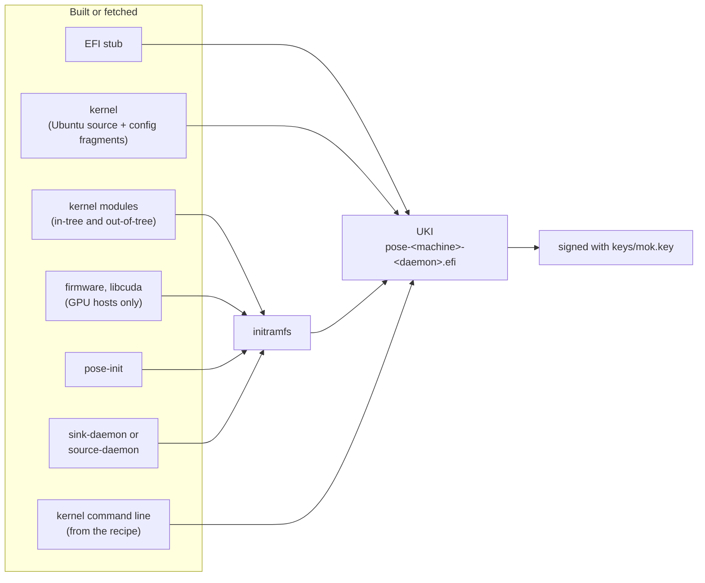

# Unified kernel images: building, deploying and adapting

This document explains the boot images in `uki/`: what is in one, how to build
the two that ship with this repository, how to get one running on a machine,
and how to write a recipe for a different kind of compute tray.

Each script's header comment is its reference. If this document and a script
disagree, the script is right.

For what the daemons inside the image do once they are running, see
[`sink-source-architecture.md`](sink-source-architecture.md).

## Overview

A daemon that labels a machine's RAM cannot run under that machine's normal
operating system. The OS is using the RAM, and it is running from the disks
that are about to be overwritten. So the machine is rebooted into a small image
that exists only for the wipe.

That image is a Linux kernel and an initramfs that holds four kinds of thing: a
tiny init program, one daemon, the handful of kernel modules the machine needs
to reach the network, and any firmware those modules load. There is no shell,
no package manager and no service manager. Everything runs from RAM, and
nothing is ever mounted from a disk.

Three properties of the image matter:

- **The kernel is told to ignore most of the RAM.** A parameter such as
  `mem=6G` makes the kernel use only a small part of the installed memory. The
  rest is the **carve-out**: RAM that nothing is using, which the daemon can
  overwrite completely.
- **It is one signed file.** Kernel, initramfs and kernel command line are
  packed into a single EFI executable, a *Unified Kernel Image*, and signed as
  a whole. The command line carries the network addresses and names the
  program to run, so the signature covers the configuration as well as the
  code.
- **Nothing is installed on the target.** The firmware fetches the image over
  the network for one boot. The daemon serves one run, wipes its own memory
  and halts or reboots.

The image is specific to a machine. It names that machine's network cards by
MAC address, lists its drivers and knows its memory layout. The two recipes in
this repository describe Amodo's test tray. The second half of this document is
about changing them for yours.

## Vocabulary

| Term | Meaning |
|---|---|
| **UKI** | Unified Kernel Image. One EFI executable containing a kernel, an initramfs and a command line. UEFI firmware can boot it directly, with no bootloader. |
| **EFI stub** | The small program at the front of a UKI that the firmware actually starts. It unpacks the rest and jumps into the kernel. Taken from systemd. |
| **Initramfs** | A compressed archive the kernel unpacks into RAM and uses as its root filesystem. |
| **PID 1** | The first process the kernel starts. If it exits, the kernel panics. |
| **`pose-init`** | This repository's PID 1. It sets the machine up, then replaces itself with the daemon. |
| **Carve-out** | Installed RAM the kernel was told not to use. The only RAM a daemon labels. |
| **Recipe** | One of the `uki/build-uki-*.sh` scripts: everything that is specific to one kind of machine. |
| **Flavour** | Ubuntu's name for a kernel variant: `generic`, `bluefield` and so on. The last part of `uname -r`. |
| **Out-of-tree module** | A kernel module that is not part of the kernel source, such as the NVIDIA GPU driver. It must be built against the exact kernel that will load it. |
| **Secure Boot `db`** | The firmware's list of certificates it will accept signatures from. |
| **BMC** | Baseboard management controller: the small computer that can power-cycle the machine and show its serial console over the network. |
| **Redfish** | The HTTP API most BMCs offer for managing the machine. |
| **SOL** | Serial-over-LAN: the machine's serial console, relayed by the BMC. |

## What is in an image



The initramfs contains exactly this:

| Path in the image | What it is |
|---|---|
| `/init` | `pose-init`, statically linked. |
| `/pose-daemon` | The daemon given to the recipe. |
| `/lib/modules/<name>.ko` | The kernel modules the recipe lists, as plain uncompressed files. |
| `/lib/firmware/...` | Firmware the modules ask for at load time. On a GPU host, the NVIDIA GSP firmware. |
| `/lib/<triplet>/...` | For a dynamically linked daemon, its loader and libraries, plus `libcuda.so.1` on a GPU host. |
| `/dev/console`, `kmsg`, `null`, `random`, `urandom` | The five device nodes needed before anything else exists. |

### The kernel

The kernel is Ubuntu's, built from Ubuntu's own source and configuration for
the flavour, with the fragments in `uki/kconfig-fragments/` merged on top. It
keeps the stock `uname -r`, so a driver built for the stock kernel still loads.

The fragments do three things:

- **Open `/dev/mem`.** A stock kernel refuses to let a process map arbitrary
  physical memory, and locks down further when Secure Boot is on. The daemon
  writes labels through `/dev/mem`, so `100-optimising-and-security.config`
  turns those restrictions off. Without this fragment a daemon offers no RAM.
- **Build in what is always a wipe target.** NVMe support is compiled into the
  kernel, so NVMe disks need no module.
- **Remove what a wipe image never uses.** Filesystems, virtualisation,
  wireless, sound, tracing and so on. This shrinks the kernel and the memory it
  keeps for itself.

### `pose-init` and the command line

`pose-init` reads its instructions from the kernel command line. Because the
command line is inside the signed image, nobody can change them without
re-signing.

| Parameter | Meaning |
|---|---|
| `pose.mods=a,b,c` | Modules to load, in this order. Each name is a file `/lib/modules/<name>.ko`. At most 16. |
| `pose.addr=SEL,CIDR[,GW]` | Give one interface a static IPv4 address. Repeat for up to 4 interfaces. `GW`, on at most one of them, becomes the default route. |
| `pose.switchdev=<PCI address>` | Put this device's embedded switch into switchdev mode before the network step. BlueField only. |
| `pose.wait=20` | Seconds to wait for each interface to appear and then for its link. |
| `pose.env=K=V,K=V` | Environment variables for the daemon. At most 8. Nothing else is passed through. |
| `pose.exec=/pose-daemon` | The program to become PID 1. |
| `pose.onfail=reboot\|halt\|park` | What to do if a step fails. `park` stops with the console readable. |

`SEL` in `pose.addr` picks the interface. There is no udev in the image to give
interfaces stable names, so the selector matters:

| Selector | Picks by | Use it for |
|---|---|---|
| `mac:8c:91:3a:d4:34:40` | MAC address | Any physical port. The preferred form. |
| `port:c1pf0` | `phys_port_name` in sysfs | Switchdev representors, whose MAC is random on every boot. |
| `iface:eth0` | Kernel name | A last resort. Kernel names depend on probe order. |

There is no DHCP client. Every address is static and written into the image.

## What happens at boot

1. The firmware fetches the image, checks its signature against the
   certificates in `db`, and starts the EFI stub.
2. The stub hands the kernel its initramfs and command line. The kernel boots
   using only the RAM below the `mem=` limit.
3. The kernel starts `/init`, which is `pose-init`. It mounts `/proc`, `/sys`
   and `/dev`, then prints its plan to the console.
4. It loads each module in `pose.mods`, in order. If the NVIDIA driver is among
   them it creates the `/dev/nvidia*` nodes.
5. It sets the eswitch mode if asked, waits for each `pose.addr` interface to
   appear, and assigns the addresses and the default route. An interface that
   never appears fails the boot. A link that never comes up does not.
6. It `exec`s `/pose-daemon` with the environment from `pose.env`. The daemon
   is now PID 1 and listens on TCP port 7776.
7. A verifier connects and the run takes place.
8. At the end the daemon overwrites its own memory pages and halts or reboots
   the machine.

If any step up to 6 fails, `pose-init` follows `pose.onfail`. The default is to
wait 30 seconds, so the console can be read, and reboot.

How the daemon ends depends on what the verifier asked for in `Finish`. The
verifier's default is to halt. The recipes also set `POSE_FINAL_ACTION=reboot`,
which is what the daemon does when the verifier asks it to "exit", since PID 1
cannot exit.

## Building the two images that ship

### What you need

- Docker or Podman, and `make`. The kernel, the out-of-tree modules, `pose-init`
  and the daemons all build inside the `pose-build` container (`make docker`).
- The packaging tools on the build machine itself, because the key, fetch,
  initramfs and UKI scripts do not run in the container:

  ```bash
  # Ubuntu
  sudo apt install openssl git curl dpkg cpio fakeroot file gzip binutils systemd-ukify sbsigntool
  # Fedora
  sudo dnf install openssl git curl dpkg cpio fakeroot file gzip binutils systemd-ukify sbsigntools
  ```

- Time and disk space for a full kernel build. First kernel build takes a while,
  but subsequent builds are much quicker.

Everything is run from the repository root.

### The steps

| Step | Command | Produces |
|---|---|---|
| 1. Signing key, once | `uki/generate-keys.sh` | `keys/mok.key`, `mok.crt`, `mok.der` |
| 2. Kernel source | `vendor/fetch-ubuntu-kernel-src.sh <kver>` | `vendor/kernel-src/<kver>/` |
| 3. Kernel | `make kernel-x86_64` or `make kernel-aarch64` | `vendor/kernel-build/<kver>/` |
| 4. Out-of-tree module source | `vendor/fetch-nvidia-modules-src.sh <driver version>` or `vendor/fetch-ofed-modules-src.sh <DOCA release>` | `vendor/nvidia-src/`, `vendor/ofed-src/` |
| 5. Out-of-tree modules | `uki/build-nvidia-modules.sh <kver>` or `uki/build-ofed-modules.sh <kver>` | `.../modules/<kver>/updates/dkms/*.ko` |
| 6. Firmware and libraries | `vendor/fetch-nvidia.sh <driver version>` | `vendor/nvidia-firmware/`, `vendor/nvidia-libcuda/` |
| 7. EFI stub | `vendor/fetch-efi-stub.sh amd64` or `arm64` | `vendor/efi-stubs/` |
| 8. Init and daemon | `make pose-init-<arch> <daemon>-<arch>` | `pose-init/build-<arch>/`, `<daemon>/build-<arch>/` |
| 9. Image | `uki/build-uki-<machine>.sh <daemon binary>` | `uki/build/pose-<machine>-<daemon>.efi` |

Steps 4 to 6 are only needed when the machine has hardware that needs them.
Each recipe checks its inputs first and, if one is missing, prints the command
that produces it.

**The x86 GPU host, running a source-daemon:**

```bash
uki/generate-keys.sh
vendor/fetch-ubuntu-kernel-src.sh 6.8.0-147-generic
vendor/fetch-efi-stub.sh amd64
vendor/fetch-nvidia.sh 595.99.02
vendor/fetch-nvidia-modules-src.sh 595.99.02
make kernel-x86_64
uki/build-nvidia-modules.sh 6.8.0-147-generic
make pose-init-x86_64 source-daemon-x86_64
uki/build-uki-x86-host.sh source-daemon/build-x86_64/source-daemon
```

**The BlueField-3 DPU, running a sink-daemon:**

```bash
vendor/fetch-ubuntu-kernel-src.sh 6.8.0-1030-bluefield
vendor/fetch-efi-stub.sh arm64
vendor/fetch-ofed-modules-src.sh 3.5.0
make kernel-aarch64
uki/build-ofed-modules.sh 6.8.0-1030-bluefield
make pose-init-aarch64 sink-daemon-aarch64
uki/build-uki-dpu.sh sink-daemon/build-aarch64/sink-daemon
```

### Where the out-of-tree module source comes from

**The NVIDIA kernel module source** is the `/usr/src/nvidia-<ver>` tree of
Ubuntu's `nvidia-kernel-source-<N>-open` package, the one a normal host builds
its driver from. `vendor/fetch-nvidia-modules-src.sh` takes the driver version and puts
the tree in `vendor/nvidia-src/nvidia-<ver>/`:

```bash
vendor/fetch-nvidia-modules-src.sh 595.99.02
```

The tree contains precompiled objects, so it is specific to an architecture.
The default is amd64; pass `-a arm64` for an Arm GPU host.

**The OFED kernel module source** is the `mlnx-ofed-kernel-dkms` package from
NVIDIA's public DOCA repository. `vendor/fetch-ofed-modules-src.sh` takes the DOCA
release, not the OFED version: it looks the OFED version up in the repository's
index, checks the download against the checksum listed there, and unpacks it to
`vendor/ofed-src/usr/src/mlnx-ofed-kernel-<ver>/`:

```bash
vendor/fetch-ofed-modules-src.sh -l 3.5.0     # show which OFED version that is, fetch nothing
vendor/fetch-ofed-modules-src.sh 3.5.0
```

The package is source only and the same for every architecture. It is taken
from the repository's x86_64 section, because the DPU's own section ships
prebuilt modules and no source.

Both build scripts use the newest version they find under `vendor/`, or the
directory given with `-o`.

### Versions that must agree

- **Kernel and modules.** An out-of-tree module is built against one kernel
  build's object tree and signed with that build's own module key. Rebuild the
  kernel and you must rebuild the modules.
- **NVIDIA driver, firmware and `libcuda`.** All three must be the same
  version. Pass the same version to `fetch-nvidia.sh` and
  `fetch-nvidia-modules-src.sh`; the recipe names it too.
- **OFED and DOCA.** The OFED source must come from the DOCA release the DPU's
  own firmware and OS run. Give `fetch-ofed-modules-src.sh` that release.

### Variants

Both recipes are controlled by environment variables.

| Variable | Recipe | Effect |
|---|---|---|
| `DEBUG=1` | both | Sets `pose.onfail=park`, so a failed boot stops with the console readable. |
| `NET=eswitch` (default) | x86 host | Configures the LAN port and the link to the DPU, and tells a source-daemon about the DPU's sink. |
| `NET=lan` | x86 host | LAN port only, no downstream sink. Use it when the DPU is not running its image. |
| `NET=eswitch` (default) | DPU | Configures the embedded switch and the out-of-band port. |
| `NET=oob`, `NET=tmfifo` | DPU | Only the out-of-band port, or only the rshim link. |
| `CARVEOUT=mem=6G` (default) | x86 host | The kernel parameter that hides RAM. `CARVEOUT=` (empty) builds with none, so the daemon offers only disks and GPUs. |

For example:

```bash
DEBUG=1 NET=lan uki/build-uki-x86-host.sh source-daemon/build-x86_64/source-daemon
```

The output file name does not change with the variant, so a new build replaces
the old one.

The DPU recipe's carve-out is fixed at `mem=640M`.

### Checking the result

The last line of a build reports the image's size, architecture, kernel and
signer, followed by the size of each section. To check the signature again
later:

```bash
sbverify --cert keys/mok.crt uki/build/pose-x86-source-daemon.efi
```

## Deploying an image

This repository builds images but contains no deployment scripts. This section
describes the method used on Amodo's test tray: the firmware fetches the image
over HTTP for one boot, set up through the BMC. The Redfish and IPMI commands
are the standard ones, but BMCs differ, so expect to adjust them.

### 1. Enrol the certificate, once per machine

The firmware will only start an image signed by a certificate in its `db`.
Enrol `keys/mok.der`, either from the firmware's setup screen (usually under
Secure Boot, then key management, then the authorised signature database) or
through the BMC if it offers that.

It must be `db`. A *Machine Owner Key* enrolled with `mokutil` is not enough:
MOK certificates are honoured by the `shim` bootloader, and an HTTP boot loads
the image directly, with no shim.

Keep `keys/mok.key` private. Anyone who has it can sign an image the machine
will boot. `generate-keys.sh` refuses to overwrite an existing key, because a
new key means enrolling again on every machine.

### 2. Serve the image over HTTP

Any web server the target's firmware can reach will do:

```bash
python3 -m http.server 8000 --directory uki/build
```

The firmware needs HTTP boot enabled on a network port, and an address for
that port, normally from DHCP. This is the firmware's own network setup and is
separate from the static addresses inside the image. For an `https://` URL the
firmware must also trust the server's certificate authority.

### 3. Arm a one-time HTTP boot

Ask the BMC to boot from the URL on the next start only. Find the system's
Redfish path, then set the override:

```bash
BMC=https://<bmc address>
curl -sk -u <user>:<password> $BMC/redfish/v1/Systems
# note the one member, e.g. /redfish/v1/Systems/Self

curl -sk -u <user>:<password> -X PATCH $BMC/redfish/v1/Systems/Self \
  -H 'Content-Type: application/json' \
  -d '{"Boot": {"BootSourceOverrideEnabled": "Once",
                "BootSourceOverrideMode": "UEFI",
                "BootSourceOverrideTarget": "UefiHttp",
                "HttpBootUri": "http://<server>:8000/pose-x86-source-daemon.efi"}}'
```

Read the system back afterwards and check the override is really there. Do not
rely on the status code.

Two differences met on the test tray:

- **Some BMCs want the current ETag.** An AMI BMC refuses the `PATCH` unless it
  carries an `If-Match` header with the `ETag` returned by a `GET` of the same
  path.
- **The BlueField-3's BMC is different again.** It refuses that `ETag`, and
  expects the `PATCH` on the system's pending-settings object instead (the path
  named by `@Redfish.Settings` in the system resource). Its firmware also only
  acts on an override that names an existing boot option. There, a boot option
  with the URL built in was first created from the DPU's own OS, and the
  override was `"BootSourceOverrideTarget": "UefiTarget"` with that option's
  device path in `UefiTargetBootSourceOverride`.

The override is cleared once it has been used. Every boot of the image needs
it armed again.

**Without a BMC or HTTP boot**, the alternative is to copy the `.efi` file to
the machine's EFI system partition and select it for the next boot with
`efibootmgr --create` and `efibootmgr --bootnext`. This has not been tested
with these images. Remember that the disk holding that partition is itself a
target of the run.

### 4. Power-cycle and watch the console

The image's only output is the serial console: `ttyS0` at 115200 baud on the
x86 host, `ttyAMA0` on the DPU. The BMC relays it:

```bash
ipmitool -I lanplus -H <bmc address> -U <user> -P <password> chassis power cycle
ipmitool -I lanplus -H <bmc address> -U <user> -P <password> sol activate
```

Run these from another machine. A host usually cannot reach its own BMC. Open
the console session *after* the power command, because a BMC drops the session
when the host resets. Type `~.` to leave it. If `sol activate` fails, SOL may
be turned off on the BMC: `sol set enabled true 1` turns it on.

You should see the firmware fetch the image, the kernel boot, then lines from
`pose-init`: its plan, each module loading, each interface matched and
addressed, and finally `exec /pose-daemon as PID 1`.

### 5. Order, and running the proof

Boot the DPU's image first, or at the same time as the host's. With
`NET=eswitch` the host's image waits for its end of the DPU's embedded switch,
and that interface only works while the DPU's driver is up. If it never
appears, the host's boot fails.

When both daemons are listening, run the verifier against the host's LAN
address, as in the README:

```bash
pose-verifier inventory <host address>
```

### 6. Afterwards

The daemon wipes its own pages and halts, or reboots if the verifier asked for
that. The boot override has been used up, so on its next start the machine
follows its normal boot order. If the run wiped the disk the OS was on, there
is no OS to come back to, and the machine needs reinstalling.

## Adapting the recipes to another tray

A recipe is short. Everything machine-specific is at the top of it: the kernel
version, the list of modules, the network block, the command line and the
carve-out. Adapting means finding those five things out for your machine.

### What the scripts support

| | Supported | Not supported |
|---|---|---|
| Architecture | x86_64 and aarch64 | Anything else. An armv7 BMC runs `sink-daemon` under its own Linux instead of booting an image. |
| Kernel | Ubuntu kernels, fetched from Launchpad by `uname -r` string | Other distributions' kernels. `build-kernel.sh` relies on Ubuntu's packaging metadata for the configuration. |
| Firmware | UEFI | Legacy BIOS boot. |
| Addresses | Static IPv4 | DHCP, IPv6. |

The architecture is chosen from the flavour: a name containing `bluefield`
means arm64, anything else amd64. `build-kernel.sh -a arm64` overrides that.
`build-nvidia-modules.sh` has the same rule and no override, so building the
GPU driver for an Arm host with a non-BlueField kernel needs that script
edited.

### Find out about the machine

Boot the machine's normal OS, ideally the Ubuntu release whose kernel you
intend to build, and collect the following.

| What | How to find it | Where it goes |
|---|---|---|
| Kernel version | `uname -r` | `KVER` |
| Driver for each network port you need | `ethtool -i <interface>`, or `readlink /sys/class/net/<interface>/device/driver` | `MODULES`, `POSE_MODS` |
| What each driver depends on | `modinfo -F depends <module>`, repeated for each result | `MODULES`, earlier in the list |
| Firmware a driver loads | `modinfo -F firmware <module>`, and `dmesg \| grep -i firmware` | a `-F` firmware tree |
| MAC address of each port | `ip -br link` | `pose.addr=mac:...` |
| Addresses, prefix and gateway | your network plan | `pose.addr` |
| Serial console device and speed | `cat /proc/cmdline`, `cat /sys/class/tty/console/active` | `console=` in `BASE` |
| Other parameters the machine needs | `cat /proc/cmdline` | `BASE` |
| RAM layout | `sudo grep 'System RAM' /proc/iomem` | `mem=` |
| PCI address of an embedded switch | `lspci -D`, `devlink dev` | `pose.switchdev=` |
| GPU driver version | `cat /proc/driver/nvidia/version` | `fetch-nvidia.sh`, `fetch-nvidia-modules-src.sh`, `GSPFW` |
| DOCA release on a DPU | `cat /etc/mlnx-release` on the DPU's own OS | `fetch-ofed-modules-src.sh` |

### Write the recipe

Copy whichever recipe is closer (`build-uki-x86-host.sh` for a host with GPUs,
`build-uki-dpu.sh` for an Arm device) and change it from the top down.

**1. Kernel version.** Set `KVER`, fetch that source and build it:

```bash
vendor/fetch-ubuntu-kernel-src.sh -l <kver>     # check it resolves, fetch nothing
vendor/fetch-ubuntu-kernel-src.sh <kver>
uki/build-kernel.sh <kver>
```

The `make kernel-*` targets use the versions set at the top of the `Makefile`;
change `KVER_x86_64` or `KVER_aarch64` there to keep using them.

**2. Modules.** For each driver, look in
`vendor/kernel-build/<kver>/config` to see how your kernel has it:

- `=y` means it is built in. Leave it out of the recipe.
- `=m` means it is a module. Add its path under
  `vendor/kernel-build/<kver>/modules/<kver>/` to `MODULES`, and its name to
  `POSE_MODS`.
- Not set means a fragment removed it, or Ubuntu never enabled it. See
  [Changing the kernel configuration](#changing-the-kernel-configuration).

`MODULES` (file paths) and `POSE_MODS` (names) must list the same modules in
the same order. `pose-init` loads them exactly as listed. It does not resolve
dependencies, so a module's dependencies must come before it.

Some dependencies are not recorded anywhere. On the DPU, the network driver
needs a GPIO driver for its interrupt, and that needs a pin-control driver;
neither appears in `modinfo`. If a device's driver loads but the device never
appears, compare `lsmod` on the working OS with your list.

Out-of-tree modules need their own build script. Use `build-nvidia-modules.sh`
and `build-nvidia-container.sh` as the pattern: copy the pristine source, build
it against `vendor/kernel-build/<kver>/obj`, strip the result, sign it with
that build's `certs/signing_key.pem`, and put it under `updates/dkms/`.

**3. Disks.** NVMe is built in. For any other storage controller (SATA, SAS,
eMMC), add its driver the same way as a network driver. A disk whose driver is
missing does not appear in the inventory, so it is silently not wiped. Check
the inventory against what you expect.

**4. Network.** Write one `pose.addr` per interface, selected by MAC. Give the
default route to the interface the verifier will arrive on. If a source-daemon
is to reach downstream sinks, add one `POSE_SINK_<node>=<address>:7776` to
`pose.env` for each.

The `NET` switch in the shipped recipes exists because the test tray has
several ways to wire host and DPU together. A recipe for one fixed layout does
not need it.

**5. Command line.** `BASE` holds the parameters that are not `pose-init`'s.
Set `console=` to the machine's serial console. Keep `panic=10`, so a kernel
panic reboots the machine and does not leave it hung. Carry over anything from
the stock OS's command line that the hardware needs.

**6. Carve-out.** `mem=` decides how much RAM the kernel keeps, and so how much
is left to label. It behaves differently on the two architectures:

- **On x86, `mem=N` is an address, not an amount.** The kernel drops every RAM
  range above physical address `N`. A typical machine has some RAM below
  4 GiB and the rest starting at 4 GiB, so `mem=6G` keeps what is below 4 GiB
  plus 2 GiB. Read `/proc/iomem` to see what a given value leaves.
- **On arm64, `mem=N` is an amount.** The kernel keeps `N` of RAM.

The kernel needs enough for itself, the unpacked initramfs, the loaded modules
and firmware, and the daemon at its busiest. Too little and the daemon runs out
of memory mid-run. For scale, on the test tray:

| Image | Kept by the kernel | Why |
|---|---|---|
| DPU, sink-daemon | 640 MiB | A sink only stores labels. |
| x86 host, source-daemon with GPUs | about 4.4 GiB (`mem=6G`) | About 1.1 GiB at startup for the kernel, initramfs, NVIDIA driver and firmware, plus a measured peak of 2.6 GiB in the daemon at `chunk_blocks` 2^18, plus page tables for the carve-out. |

A source-daemon without GPUs computes labels on the CPU, and needs working
memory per thread on top; see
[`labeling-explained.md`](labeling-explained.md#how-the-labeller-walks-the-graph).

Start generous, run a real session, and reduce. RAM the kernel keeps is never
labelled, and the verifier reports it as not proven, so there is a reason to
keep it small.

**7. GPUs.** In the x86 recipe, GPU support is switched on by the daemon's
name: a binary called `source-daemon` gets `libcuda.so.1` and `POSE_GPUS=1`.
`POSE_GPUS` is the number of GPUs the daemon must find. With it set, a start
that finds fewer is a failed boot, not a tray with GPU memory quietly missing.
Set it to the machine's real count.

`fetch-nvidia.sh` keeps only `gsp_ga10x.bin`, the firmware for Ampere and later
GPUs. Its `-A` option keeps every firmware file.

The recipe requires the NVIDIA modules and firmware even when it is given a
sink-daemon. For a host with no GPUs, remove `nvidia` and `nvidia-uvm` from
`MODULES` and `POSE_MODS`, and remove the `-F "$FWDIR"` argument and the
`need "$GSPFW"` check.

**8. Names.** Change the output file names (`initrd-x86-...`, `pose-x86-...`)
so the new recipe does not overwrite another machine's images.

### Changing the kernel configuration

Every `*.config` file in `uki/kconfig-fragments/` is applied to every kernel
build, on both architectures, in name order. To change the configuration, add
a line to a fragment or add a new fragment file.

- To get back a driver that a fragment removed, delete that line or set the
  option to `=m` in a later fragment.
- To make something built in, set it to `=y`.
- For a change that should apply to one machine only, keep the fragment
  elsewhere in the repository and pass it with `build-kernel.sh -c <file>`.

`uki/build-kernel.sh -n <kver>` configures without building. It prints a
warning for every fragment line that did not survive, which happens when
another option forces the value back. Read those warnings: a line that quietly
failed to apply is the usual reason a driver is missing.

After changing the configuration, rebuild the kernel and then every
out-of-tree module.

### Bringing up a new image

Build with `DEBUG=1` first, so that a failure stops with the console readable.

| What you see | Likely cause |
|---|---|
| The firmware refuses the image or falls through to the next boot option | The certificate is not in `db`, or the image was fetched from the wrong URL. |
| Nothing on the console after the firmware | Wrong `console=`. The kernel is probably running. |
| The machine resets a few seconds into boot | A firmware watchdog nobody is servicing. The DPU needs `sbsa_gwdt` loaded first for this reason. |
| A module fails to load | Built against a different kernel build, not signed with this build's key, or listed before one of its dependencies. |
| `pose-init` reports that an interface never appeared | The driver or one of its unrecorded dependencies is missing, the MAC is wrong, or, for the host's eswitch port, the DPU is not up. `pose-init` lists the interfaces it can see. |
| The interface is up but nothing can reach the daemon | Wrong address or prefix, or no default route for a verifier on another subnet. |
| The inventory shows no RAM target | No `mem=` on the command line, or the `/dev/mem` fragment did not apply. |
| The inventory is missing a disk | Its controller's driver is not in the image. |
| A source-daemon fails to start with a `POSE_GPUS` message | Driver, firmware and `libcuda` versions differ, or the firmware file for this GPU generation was not packed. |
| The daemon dies during a session | The kernel kept too little RAM. Raise `mem=`. |

## Where to find it in the code

| What | Where |
|---|---|
| The two machine recipes | `uki/build-uki-x86-host.sh`, `uki/build-uki-dpu.sh` |
| Packing the initramfs | `uki/build-initramfs.sh` |
| Assembling and signing the UKI | `uki/build-uki.sh` |
| Signing key generation | `uki/generate-keys.sh` |
| Kernel build | `uki/build-kernel.sh`, `uki/build-kernel-container.sh` |
| Kernel configuration changes | `uki/kconfig-fragments/` |
| Out-of-tree module builds | `uki/build-nvidia-modules.sh`, `uki/build-ofed-modules.sh` and their `-container.sh` halves |
| Fetching kernel source, EFI stub, NVIDIA firmware and `libcuda`, and the NVIDIA and OFED module source | `vendor/fetch-*.sh` |
| The init program and its command-line parameters | `pose-init/pose_init.c` |
| How a daemon ends as PID 1 | `pose-sink/src/self_wipe.c` |
| Gathering a dynamic daemon's libraries | `cmake/pose-runtime.cmake`, `cmake/gather-runtime.sh` |
| How a daemon finds its carve-out | `pose-sink/src/sink_inventory.c` |
